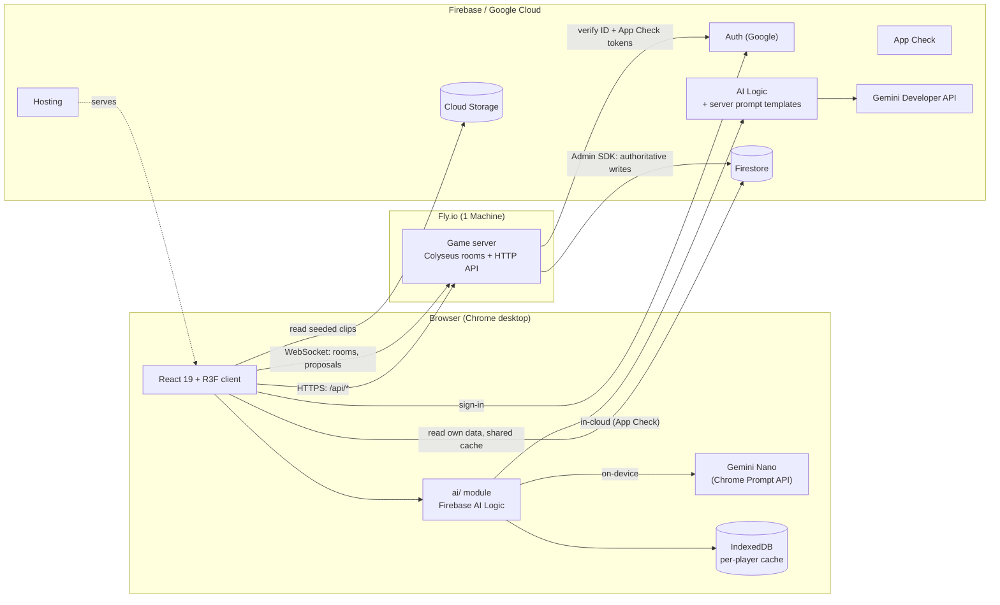
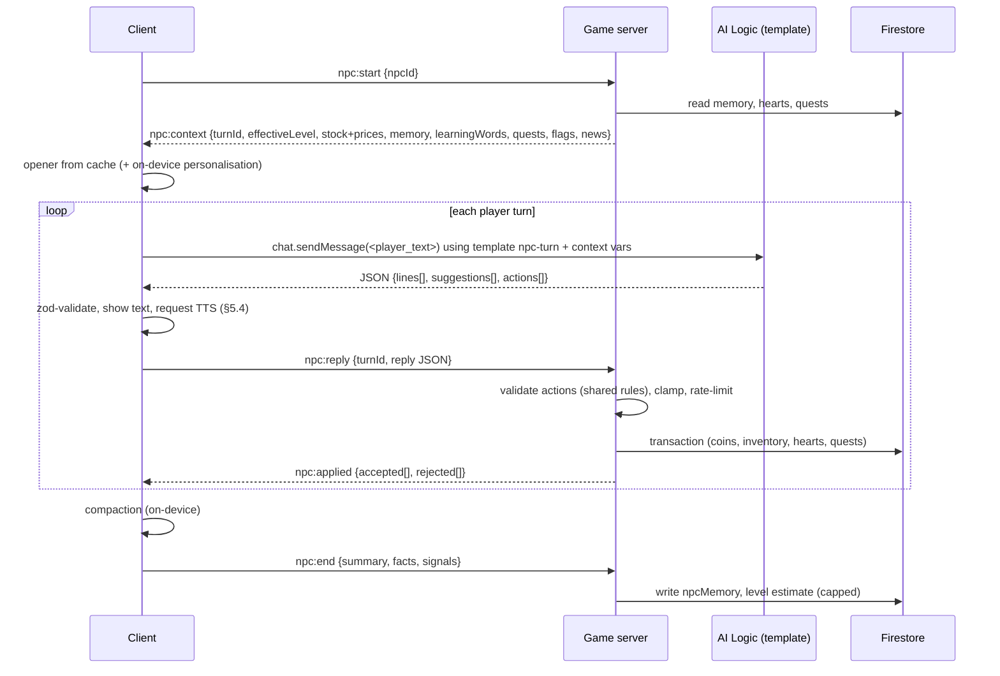

# HelloValley — Architecture

Companion to the [GDD](game-design-document.md). Where this document and GDD §9.1–9.2 disagree, this document wins (see [§11](#11-changes-from-the-gdd)).

Status: v1, 2026-11-25.

## 1. Principles

1. **All AI runs in the client, through Firebase AI Logic.** On-device Gemini Nano handles small tasks, and cloud Gemini handles NPC dialogue and voices. Every call goes from the browser to Firebase. The game server never calls a model.
2. **The game server is authoritative for game state.** It owns positions, coins, inventory, hearts, quests and the world clock. Model output reaches it as an untrusted *proposal*, which it validates against shared rules before anything changes.
3. **Firebase is the only persistence layer.** Firestore holds durable data, and Cloud Storage holds audio. The game server keeps only live room state in memory.
4. **Cache before generating.** Content that many players see is generated once by a trusted tool and shared. Everything else is cached per player.
5. **One small deployable.** A single Fly.io Machine runs Colyseus and the HTTP API. Scaling out is a later step, not a v1 requirement.

## 2. Components



| Component | Where | Responsibility |
|---|---|---|
| `packages/client` | Firebase Hosting | Rendering, input, UI, **every AI call** (`src/ai/`), per-player caches |
| `packages/shared` | Imported by client and server | Protocol and zod schemas, game data and rules, action validation, difficulty, SRS, town layout, A* |
| `packages/server` | Fly.io | Colyseus `TownRoom` / `ApartmentRoom`, HTTP API, validation of model proposals, Firestore writes through the Admin SDK |
| Firebase | Google Cloud | Auth, Firestore, Storage, Hosting, App Check, AI Logic (model proxy, server prompt templates, per-user quotas) |
| Seeding tool | Developer's browser (admin only) | Generates the shared content (openers, barks, labels, intro lines and their audio) into `cache/*` |

## 3. Deployment

### 3.1 Game server on Fly.io

- **One Machine** in the primary region, which should be close to the Firestore location because every transaction is a round trip. Set the region in `fly.toml`.
- WebSockets must not be cut off when the server looks idle:
  ```toml
  [http_service]
    internal_port = 8080
    force_https = true
    auto_stop_machines = "off"
    auto_start_machines = true
    [http_service.concurrency]
      type = "connections"
      soft_limit = 400
  ```
- **Secrets** (`fly secrets set`): a Firebase service account JSON for the Admin SDK, with least privilege (Firestore read/write and App Check token verification), and `FIREBASE_PROJECT_ID`. Fly has no Google default credentials, so the key is required.
- **Restarts and deploys drop every connection.** Clients reconnect automatically and rejoin a shard. Nothing durable is lost, because:
  - economy changes are written to Firestore as soon as they happen (§6.2);
  - the world clock comes from wall time, so it survives restarts: `worldTime = ((Date.now() − EPOCH) mod 40 min) / 40 min`;
  - daily spawns (forage, lost items, requests) are seeded from the in-game day index, so the server recomputes the same set after a restart.

### 3.2 Firebase

- **Hosting** serves the client build. Preview channels are used for PRs.
- **Firestore** and **Storage** use the same location. Rules and indexes are deployed from the repo.
- **AI Logic** uses the Gemini Developer API (`GoogleAIBackend`). App Check is **enforced** for AI Logic, Firestore and Storage, with reCAPTCHA Enterprise as the web provider.
- **Server prompt templates** are kept under version control in the repo (§5.3) and copied to the console with a semver ID suffix (`npc-turn-v1-0-0`). The client reads the active template IDs from Remote Config, so a prompt can change without shipping a new client.

### 3.3 Environments

| Env | Client | Game server | Firebase |
|---|---|---|---|
| Local | `npm run dev` (Vite, `127.0.0.1:5173`) | `npm run dev` (same command) | Emulators for Auth, Firestore and Storage. AI Logic has no emulator, so a dev Firebase project with App Check debug tokens is used |
| Prod | Firebase Hosting | Fly.io | Prod project |

## 4. Client

```
packages/client/src/
  ai/          hybrid.ts (routing table, §5.2), templates.ts (NPC turn), tts.ts, cache.ts
  net/         Colyseus client, HTTP client (attaches ID + App Check tokens)
  scene/       R3F diorama, kit loader, building assembler
  ui/          conversation panel, bubbles, notebook, inventory, onboarding
  state/       Zustand stores (UI state only; game state mirrors the room)
```

- Game state on the client is a **mirror** of the Colyseus room state. The client never decides coins, inventory or hearts.
- The client writes directly to Firestore only for its own profile and settings (appearance, script mode, style) and its notebook. Rules restrict this to `users/{uid}` and exclude economy fields.

## 5. AI

### 5.1 Models

| Use | Model | Notes |
|---|---|---|
| NPC dialogue turns, seeded text | `gemini-3.8-flash` | Runs from a server prompt template (cloud only) |
| Cloud fallback for small tasks | `gemini-3.5-flash-lite` | Also the AI Logic default for hybrid `inCloudParams` |
| On-device | Gemini Nano (Chrome 139+) | Single-turn prompts only, no tools, no templates |
| TTS | `gemini-3.1-flash-tts-preview` | The TTS model listed for AI Logic. Returns raw PCM (24 kHz, mono, 16-bit) |

Model IDs live in one place (`shared/src/ai/models.ts`), and templates name their model in their frontmatter. The NPC doc mentions `gemini-3.8-flash-lite-tts`, which is not in the AI Logic model list. Check that the voices and inline tags in [NPC doc § Voice](hellovalley-village-npcs.md#voice-and-speaking-tone-tts) work with the TTS model above before relying on them.

### 5.2 Routing

| Task | API | Mode | Fallback |
|---|---|---|---|
| Word gloss, short translation (≤ 25 words) | hybrid `generateContent` | `PREFER_ON_DEVICE` | Cloud flash-lite (automatic), then an "unavailable" chip |
| Long translation, P2P chat ≥ 25 words | hybrid | `PREFER_IN_CLOUD` | On-device |
| Grammar feedback | hybrid | `ONLY_ON_DEVICE` | Skip silently |
| Chat moderation, sender before sending | hybrid | `PREFER_ON_DEVICE` | Server blocklist only |
| Chat moderation, reader before displaying | hybrid | `ONLY_ON_DEVICE` | Server blocklist only |
| Conversation compaction + level signals | hybrid | `PREFER_ON_DEVICE` | Keep the previous summary |
| Opener personalisation | hybrid | `ONLY_ON_DEVICE` | Use the cached opener as is |
| **NPC dialogue turn** | template chat (`npc-turn`) | cloud | Canned lines + "the NPC is busy, come back later" |
| **TTS** | `generateContent` with `responseModalities: [AUDIO]` | cloud | Text only, with a 🔇 badge |
| Gossip rumours / Elder legends | inside the Gossip and Elder turns (the server passes recent events as template variables) | cloud | No news |
| Shared content (openers, barks, labels, intro) | seeding tool | cloud | Per-player generation on a cache miss |

Every hybrid task is one prompt with a small JSON answer. The schema is passed both as `inCloudParams.generationConfig.responseSchema` and as `onDeviceParams.promptOptions.responseConstraint`. The answer is validated with zod and retried once. The prompts are in [npc-runtime.md §On-device](prompts/npc-runtime.md).

**Warm-up**: at login the client calls `LanguageModel.availability()`. If the model is `downloadable`, the client starts the download during character creation and shows a status chip (GDD §9.2).

### 5.3 NPC turn flow

The persona and system prompt stay inside the server prompt template, so the client never sees them. The game server supplies the context, and it has the final say on what happens.



- **Templates**: the sources live in `packages/shared/src/ai/templates/*.prompt` (Dotprompt). The client fills only the declared template variables. Template output schemas cannot constrain values to an enum list yet, so `actions[].type` comes back as a string, and zod checks it against the allowed action list.
- **History**: the template chat session keeps the last 8 turns, and the session is discarded on `npc:end`.
- **Streaming**: show text as it streams if the template chat API supports streaming. Otherwise show the whole reply at once. Check this in M21.
- Templates do not support hybrid inference, so NPC turns are always cloud.

### 5.4 TTS flow

1. The client hashes the line: `sha256(npcId, lang, level, text)`.
2. If the line is seeded content, it is read from `cache/tts/{hash}`, which points to a Storage clip.
3. Otherwise the client checks its IndexedDB cache. On a miss it calls the TTS model with the NPC's voice, plays the PCM through Web Audio, and stores the clip in IndexedDB.
4. A1–A2 lines get a slower delivery through the style prompt. The 🐢 button replays at 0.75× on the client, with no new generation.

Text always appears before its audio.

## 6. Trust model

### 6.1 What the client is trusted with

Because every model call runs in the client, the reply JSON that reaches the server could be forged. That is acceptable because the server never trusts what the model says:

| Proposal | Server check |
|---|---|
| `offer(itemId, price)` / `buy(itemId, price)` | Item must be in this NPC's buy or sell list. The server ignores the proposed price and recomputes it from `shared/items.ts` × the clamped adjustment |
| `priceAdjustment(pct)` | Shopkeeper only. Clamped to −30%..+10% and scaled by friendship. At most once per item per conversation |
| `friendshipDelta(d)` | Clamped to −1..+1. At most +1 per conversation and +2 per NPC per in-game day |
| `give(itemId)` | Only from this NPC's gift table, at most one per NPC per in-game day |
| `giveQuest(questId)` | Only quests offered today to this player by this NPC |
| `completeQuest(questId)` | Only if the server-side conditions hold (inventory, location, time). What the model says does not count |
| `teachRecipe(recipeId)` | Only the NPC's own recipes, and only above their heart threshold |
| `npc:end` summary and signals | Length caps (120 words, 10 facts), sanitised. The level moves at most ½ step per in-game day |

A forged reply can therefore get at most what a perfect conversation gets. Each `npc:reply` must carry a `turnId` that the server issued, and the server limits the number of turns per conversation and per day.

### 6.2 Authoritative writes

The game server writes economy fields (coins, inventory, hearts, quests, level, npcMemory) with the Admin SDK, inside Firestore transactions, as each change is accepted. Room state is rebuilt from Firestore when a player rejoins.

### 6.3 Shared cache integrity

Anything in `cache/*` or Storage `tts/` is seen by many players, so **only trusted writers create it**: the seeding tool, running as a user with the `admin: true` custom claim, which a script sets through the Admin SDK. Lines generated during play (dialogue audio, glosses, translations) are cached only in the player's own IndexedDB. One player can therefore never poison another player's content.

Seeding covers the [featured languages](prompts/build-plan.md#m02--shared-domain-data) first: openers by NPC × language × level band × time band × friendship band, plus barks, world labels and the intro cutscene. Other languages fall back to generation per player on a cache miss.

### 6.4 Moderation and safety

There is no model on the server, so moderation is split:

- **Game server (always runs)**: a blocklist, message rate limits, mute, block and report, and shard-wide mutes for repeat offenders. Reports go to `reports/{id}`.
- **Sender's client**: an on-device check before sending (the soft "are you sure?" prompt).
- **Reader's client**: an on-device check before showing a message. Flagged messages are collapsed with "show anyway".

Player text always goes into prompts as quoted data (`<player_text>`), never as instructions (GDD §9.3).

## 7. Game server

### 7.1 Colyseus rooms

- **`TownRoom`**: up to 40 clients. The in-process matchmaker fills existing shards before creating a new one. "Join a friend" looks the friend up in an in-memory uid → roomId map, which works because there is only one instance.
- **`ApartmentRoom`**: one private instance per owner. Visits go through the lobby intercom (owner accepts).
- **`onAuth`** verifies the Firebase ID token passed in the join options and rejects users who have not finished onboarding.
- **Room state** (schema-synced): players (position, animation, appearance), NPCs (position, schedule state), world time, weather, spawns. Economy data is sent only to its owner, as messages.
- **Message names and payload schemas** live in `shared/src/protocol/`.

### 7.2 HTTP API

The HTTP API runs on Express in the same process as Colyseus. Every `/api/*` request must carry `Authorization: Bearer <Firebase ID token>` and `X-Firebase-AppCheck: <token>`, and both are verified with the Admin SDK.

| Route | Purpose |
|---|---|
| `GET /healthz` | Liveness check for Fly (no auth) |
| `POST /api/onboarding` | Validates the profile (name moderation through the blocklist), assigns `apartmentId` and starting coins, creates `users/{uid}` and `users/{uid}/langs/{lang}` |
| `POST /api/langs` | Adds another target language |
| `GET /api/shards` | Lists shards and whether friends are online, for the shard picker |

Everything inside a session (movement, chat, NPC turns, shops, fishing) goes over the room connection, not HTTP.

## 8. Data

### 8.1 Firestore ownership

Based on GDD §9.4.

| Path | Client reads | Client writes | Server writes |
|---|---|---|---|
| `users/{uid}` (profile, appearance, settings) | own | own, except `apartmentId` | create |
| `users/{uid}/langs/{lang}` | own | `settings` only | level, levelEstimate, streak, coins, hearts |
| `users/{uid}/langs/{lang}/notebook/{id}` | own | own | — |
| `users/{uid}/langs/{lang}/npcMemory/{npcId}` | own | — | yes |
| `users/{uid}/inventory/{slot}`, `apartment/layout` | own | — | yes |
| `users/{uid}/collections/fish` (fish encyclopedia, build plan M27) | — (sent over the room) | — | yes |
| `users/{uid}/collections/forage` (forage album, build plan M28) | — (sent over the room) | — | yes |
| `users/{uid}/collections/recipes` (recipe book, build plan M29) | — (sent over the room) | — | yes |
| `users/{uid}/collections/quests` (quest log per target language, build plan M30) | — (sent over the room) | — | yes |
| `village/{shardId}/events/{id}` (TTL 14 days) | — | — | yes |
| `cache/lines`, `cache/tts`, `cache/labels` | signed-in | admin claim only | — |
| `reports/{id}` | — | — | yes |

`village/global/legends` from GDD §9.4 is no longer needed, because legends are generated inside the Elder's turns.

Delegate `firestore.rules` authoring to the `firebase:firestore-rules-author` subagent, and test the rules against the emulator (build plan M03).

### 8.2 Storage

- `tts/{hash}.ogg`: seeded clips (PCM encoded to Opus by the seeding tool). Readable by signed-in users, writable by the admin claim only.
- Style kits (GLB and KTX2) ship with the client on Hosting, not in Storage.

### 8.3 Cache layers (client)

1. A memory LRU for the current session.
2. IndexedDB per uid for glosses, translations and dialogue audio. It is size-capped and evicts the oldest entries first. All access is wrapped so private mode still works.
3. Seeded shared content from Firestore `cache/*` and Storage.

Keys are content hashes: `sha256(kind, npcId, lang, level, text)`.

## 9. Cost controls

The game server is not on the AI request path, so it cannot cap spending. The hard caps are on Firebase and Google Cloud:

- **App Check enforced on AI Logic**: only the real web app can call the models.
- **AI Logic per-user rate limit**: the default is 100 RPM per user, project-wide. Lower it (for example to 20 RPM).
- **Gemini API quotas and a billing budget alert** on the Google Cloud project.
- **Game-level limits**: the server issues a limited number of `turnId`s per conversation and per day. Calling the model without a `turnId` costs the player quota but has no game effect.
- **Cheap defaults**: on-device first, flash-lite for cloud fallbacks, short context (memory summaries instead of transcripts), seeded openers, and per-player caching.
- The models above do not need a Blaze plan on the Developer API, but free-tier quotas are small. Switch to Blaze before multiplayer demos.
- Optional later hardening: AI Logic pre-request scripts (Cloud Functions) for token caps and logging.

## 10. Local development

- `npm run dev` starts Vite and the game server together, both pointed at the Firebase emulators for Auth, Firestore and Storage.
- AI Logic calls use the dev Firebase project with an App Check debug token. On-device inference needs Chrome 139+ with `chrome://flags/#prompt-api-for-gemini-nano-multimodal-input` enabled. Check `await LanguageModel.availability()` in the console.
- Tests mock the `ai/` module. Shared validation (actions, clamps, caps) is unit-tested in `packages/shared`.

## 11. Changes from the GDD

These replace the parts of GDD §9.1–9.2, §8.2, §9.4 and the build plan (M01, M21, M22, M31, M36, M38) that assume server-side AI:

| GDD / build plan | Now |
|---|---|
| Server calls Gemini Flash and TTS | The client calls them through AI Logic. The server validates the proposals (§6.1) |
| Server is hosted on Cloud Run | One Fly.io Machine |
| Server-side cache of TTS and lines, with signed URLs | Shared cache is admin-seeded only. Play-time content is cached per player in IndexedDB |
| Server-side AI moderation | Server blocklist + on-device checks on the sender and reader sides |
| Village rumours and legends batch job | Generated inside the Gossip and Elder turns from events the server supplies |
| Server per-user AI budgets | AI Logic per-user RPM limit + App Check + project quotas, plus server `turnId` limits |

## 12. Open questions

- Does the template chat API support streaming on the web? (Affects first-text latency, GDD §9.5.)
- Server prompt templates are in Preview, with no SLA. Fallback plan: inline prompts in the client, which exposes the prompts but keeps the same server validation.
- TTS voice and tag behaviour on `gemini-3.1-flash-tts-preview` compared with the voices chosen in the NPC doc.
- Fly region versus Firestore location: pick them together.
